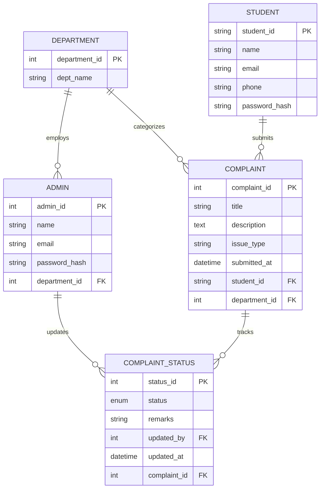

# 🎓 College Complaint Management System

A full-stack DBMS Mini Project designed to streamline campus issue reporting, tracking, and departmental resolution. Built using **React (Vite)**, **Tailwind CSS**, **Node.js / Express**, and **MySQL**.


## 📌 Overview

The **College Complaint Management System** provides a transparent, centralized web platform for students to report issues regarding campus infrastructure, faculty, library, hostel, and administrative services. Departmental administrators receive complaints tailored to their specific domain and can update progress in real time with official resolution remarks.

---

## ✨ Key Features

### 👨‍🎓 Student Portal
- **Secure Authentication**: Student registration with USN (University Seat Number or SSN) validation and JWT-based authentication.
- **File New Complaint**: Interactive modal with pre-defined department suggestion buttons (Infrastructure, Faculty, Library, Hostel, Others) and custom title support.
- **Status Dashboard**: At-a-glance statistic cards for Total, Pending, In Progress, and Completed complaints.
- **Filter & Search**: Quick filter buttons (All, Pending, In Progress, Completed) with pill-style tab controls.
- **Status History Timeline**: Modal popup showing step-by-step progress, timestamps, and administrator remarks.

### 🛡️ Admin Portal
- **Departmental Isolation**: Admins log in to manage complaints strictly assigned to their department.
- **Interactive Overview**: Visual status overview progress bar displaying real-time complaint distribution.
- **Status Update Workflow**: Quick status buttons (Pending, In Progress, Resolved, Rejected) with custom remarks.
- **Student Verification**: Access student details (Name, USN, Email, Phone) directly within complaint management dialogs.

### 🎨 Modern UI & UX
- Clean blue color theme (`#2563EB` primary).
- Fully responsive across Desktop, Laptop, Tablet, and Mobile screens.
- Accessible forms, clear status badge indicators, and zero horizontal scrolling.

---

## 🛠️ Tech Stack

| Layer | Technology | Description |
| :--- | :--- | :--- |
| **Frontend** | React 18, Vite | High-performance Single Page Application |
| **Styling** | Tailwind CSS, Lucide Icons | Responsive utility-first CSS & modern UI icon library |
| **Routing** | React Router v6 | Client-side routing and protected routes |
| **Backend API** | Node.js, Express.js | RESTful API server with modular controllers & routes |
| **Database** | MySQL 8.0 (`mysql2`) | Relational database with foreign key constraints & cascades |
| **Authentication** | JWT & bcryptjs | Token-based auth and secure password hashing |

---

## 🗄️ Database Schema & Architecture

The relational database `complaint_db_arun_master` consists of **5 interconnected tables**:



### Table Details
1. **`department`**: Stores core college departments (`Infrastructure`, `Faculty`, `Library`, `Hostel`, `Others`).
2. **`student`**: Student account data using USN as Primary Key.
3. **`admin`**: Departmental administrator accounts linked 1-to-1 with a department.
4. **`complaint`**: Primary complaint entries referencing `student_id` and `department_id`.
5. **`complaint_status`**: Audit timeline table tracking status transitions (`Pending`, `In Progress`, `Resolved`, `Rejected`) and admin remarks.

---

## 📁 Project Directory Structure

```text
arun-DB-Master/
├── backend/
│   ├── config/
│   │   └── db.js             # MySQL connection pool configuration
│   ├── constants/
│   │   └── categories.js     # Department & category constants
│   ├── controllers/
│   │   ├── adminController.js # Admin operations & status updates
│   │   ├── authController.js  # Student/Admin registration & login
│   │   └── complaintController.js # Complaint creation & fetching
│   ├── middleware/
│   │   └── authMiddleware.js # JWT verification & role authorization
│   ├── routes/
│   │   ├── admin.js          # Admin endpoint routes
│   │   ├── auth.js           # Auth endpoint routes
│   │   └── complaints.js     # Student complaint routes
│   ├── .env.example          # Sample backend environment file
│   ├── init-db.js            # Automated MySQL database initialization script
│   ├── schema.sql            # MySQL DDL & DML seed script
│   └── server.js             # Express application entry point
├── frontend/
│   ├── src/
│   │   ├── components/
│   │   │   ├── auth/         # Modular auth UI components
│   │   │   ├── ComplaintCard.jsx # Reusable complaint card
│   │   │   ├── ComplaintForm.jsx # New complaint creation form
│   │   │   ├── Navbar.jsx    # Application navigation bar
│   │   │   └── ProtectedRoute.jsx # Auth route wrapper
│   │   ├── context/
│   │   │   └── AuthContext.jsx # React context for JWT state
│   │   ├── pages/
│   │   │   ├── AdminDashboard.jsx # Department admin portal
│   │   │   ├── Login.jsx     # Student/Admin login page
│   │   │   ├── Register.jsx  # Student registration page
│   │   │   └── StudentDashboard.jsx # Student portal
│   │   ├── services/
│   │   │   └── api.js        # Axios HTTP client configuration
│   │   ├── App.jsx           # Main application router
│   │   ├── index.css         # Tailwind base styles
│   │   └── main.jsx          # React app DOM root
│   ├── index.html            # Vite HTML template
│   ├── tailwind.config.js    # Tailwind design tokens & themes
│   └── vite.config.js        # Vite bundler configuration
├── package.json              # Monorepo root scripts (concurrently)
└── README.md                 # Project documentation
```

---

## 🚀 Getting Started

### Prerequisites
Make sure you have installed:
- **Node.js** (v18.0.0 or higher)
- **npm** (v9.0.0 or higher)
- **MySQL Server** (v8.0 or higher)

---

### 1. Install Dependencies

Clone the repository and run the setup command from the project root directory:

```bash
# Clone the repository
git clone https://github.com/DarshanKudrigi/college-complaint-management-system.git
cd college-complaint-management-system

# Install root dependencies
npm install

# Install both frontend and backend dependencies simultaneously
npm run install:all
```

---

### 2. Environment Variables

Create environment configuration files for both backend and frontend.

#### Backend Configuration (`backend/.env`):
```bash
# Windows Command Prompt / PowerShell
copy backend\.env.example backend\.env
```
Fill in your local MySQL database credentials inside `backend/.env`:
```env
PORT=8000
CLIENT_ORIGIN=http://localhost:5173
DB_HOST=localhost
DB_PORT=3306
DB_USER=root
DB_PASSWORD=your_mysql_password
DB_NAME=complaint_db
JWT_SECRET=your_jwt_secret_key_123
```

#### Frontend Configuration (`frontend/.env.local`):
```bash
copy frontend\.env.example frontend\.env.local
```
Verify `frontend/.env.local`:
```env
VITE_API_URL=http://localhost:8000/api
```

---

### 3. MySQL Database Setup

Execute the schema DDL script using MySQL CLI or the provided Node.js script:

#### Option A: Using MySQL CLI
```bash
mysql -u root -p < backend/schema.sql
```

#### Option B: Using Backend Auto-Init Script
```bash
npm --prefix backend run init-db
```

---

### 4. Running the Project

#### One-Command Startup (Frontend + Backend):
From the root directory:
```bash
npm run dev
```

#### Running Components Separately:
```bash
# Terminal 1: Start Backend Server (runs on http://localhost:8000)
npm --prefix backend run dev

# Terminal 2: Start Frontend Vite Dev Server (runs on http://localhost:5173)
npm --prefix frontend run dev
```

Open `http://localhost:5173` in your browser to view the application.

---

## 🔑 Default Login Credentials

Seed data includes pre-configured **Department Administrator** accounts for testing (Password for all admin accounts is `password123`):

| Role / Department | Email | Default Password |
| :--- | :--- | :--- |
| **Infrastructure Admin** | `infrastructure@college.edu` | `password123` |
| **Faculty Admin** | `faculty@college.edu` | `password123` |
| **Library Admin** | `library@college.edu` | `password123` |
| **Hostel Admin** | `hostel@college.edu` | `password123` |
| **Others Admin** | `others@college.edu` | `password123` |

> 💡 **Note**: Students can register a new account on the `/register` page using a valid USN format (e.g., `4NI24IS040`).

---

## 📡 API Endpoints Reference

### Auth Routes (`/api/auth`)
| Method | Endpoint | Access | Description |
| :--- | :--- | :--- | :--- |
| `POST` | `/api/auth/register` | Public | Register new student account |
| `POST` | `/api/auth/login/student` | Public | Authenticate student & generate JWT |
| `POST` | `/api/auth/login/admin` | Public | Authenticate department admin & generate JWT |
| `GET` | `/api/auth/categories` | Public | Get list of available complaint categories |

### Student Complaint Routes (`/api/complaints`)
| Method | Endpoint | Access | Description |
| :--- | :--- | :--- | :--- |
| `GET` | `/api/complaints` | Student | Fetch logged-in student's complaints |
| `POST` | `/api/complaints/file` | Student | Submit a new complaint |
| `GET` | `/api/complaints/:id` | Authenticated | Get detailed complaint information & status history |
| `GET` | `/api/complaints/departments` | Authenticated | Get list of departments |

### Admin Routes (`/api/admin`)
| Method | Endpoint | Access | Description |
| :--- | :--- | :--- | :--- |
| `GET` | `/api/admin/complaints` | Admin | Fetch complaints assigned to admin's department |
| `PATCH` | `/api/admin/complaints/:id/status` | Admin | Update complaint status & attach resolution remarks |

---

## 📄 License

Distributed under the MIT License. See `LICENSE` for more information.

-----------

<p center>Made for Complaint managment system</p>
