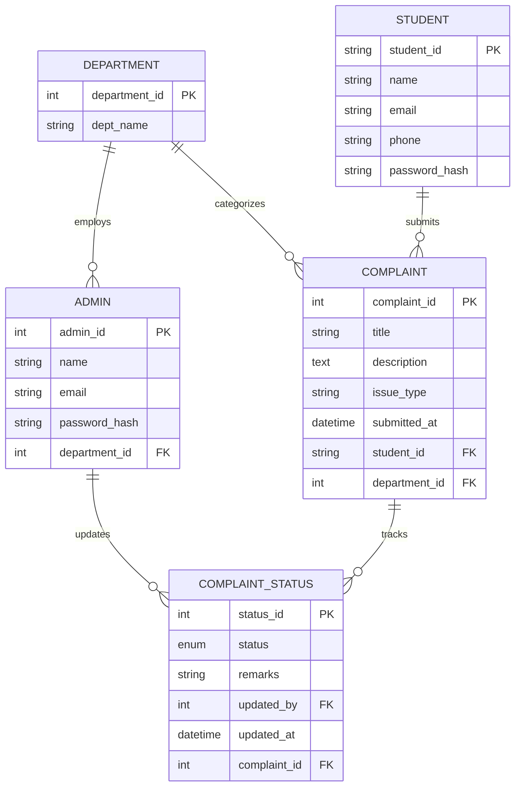

# 🎓 College Complaint Management System

A full-stack DBMS Mini Project designed to streamline campus issue reporting, tracking, and departmental resolution. Built using **React (Vite)**, **Tailwind CSS**, **Node.js / Express**, and **Neon PostgreSQL**.


## 📌 Overview

The **College Complaint Management System** provides a transparent, centralized web platform for students to report issues regarding campus infrastructure, faculty, library, hostel, and administrative services. Departmental administrators receive complaints tailored to their specific domain and can update progress in real time with official resolution remarks.

---

## ✨ Key Features

### 👨‍🎓 Student Portal
- **Secure Authentication**: Student registration with USN (University Seat Number or SSN) validation and JWT-based authentication.
- **File New Complaint**: Interactive modal with pre-defined department suggestion buttons (Infrastructure, Faculty, Library, Hostel, Others) and custom title support.
- **Status Dashboard**: At-a-glance statistic cards for Total, Pending, In Progress, and Completed complaints.
- **Filter & Search**: Quick filter buttons (All, Pending, In Progress, Completed) with pill-style tab controls.
- **Status History Timeline**: Modal popup showing step-by-step progress, timestamps, and administrator remarks.

### 🛡️ Admin Portal
- **Departmental Isolation**: Admins log in to manage complaints strictly assigned to their department.
- **Interactive Overview**: Visual status overview progress bar displaying real-time complaint distribution.
- **Status Update Workflow**: Quick status buttons (Pending, In Progress, Resolved, Rejected) with custom remarks.
- **Student Verification**: Access student details (Name, USN, Email, Phone) directly within complaint management dialogs.

### 🎨 Modern UI & UX
- Clean blue color theme (`#2563EB` primary).
- Fully responsive across Desktop, Laptop, Tablet, and Mobile screens.
- Accessible forms, clear status badge indicators, and zero horizontal scrolling.

---

## 🛠️ Tech Stack

| Layer | Technology | Description |
| :--- | :--- | :--- |
| **Frontend** | React 18, Vite | High-performance Single Page Application |
| **Styling** | Tailwind CSS, Lucide Icons | Responsive utility-first CSS & modern UI icon library |
| **Routing** | React Router v6 | Client-side routing and protected routes |
| **Backend API** | Node.js, Express.js | RESTful API server with modular controllers & routes |
| **Database** | Neon PostgreSQL (`pg`) | Hosted relational database with foreign key constraints |
| **Authentication** | JWT & bcryptjs | Token-based auth and secure password hashing |

---

## 🗄️ Database Schema & Architecture

The Neon PostgreSQL database consists of the department, administrator,
student, complaint, and complaint-status tables used by the application.



### Table Details
1. **`department`**: Stores core college departments (`Infrastructure`, `Faculty`, `Library`, `Hostel`, `Others`).
2. **`student`**: Student account data using USN as Primary Key.
3. **`admin`**: Departmental administrator accounts linked 1-to-1 with a department.
4. **`complaint`**: Primary complaint entries referencing `student_id` and `department_id`.
5. **`complaint_status`**: Audit timeline table tracking status transitions (`Pending`, `In Progress`, `Resolved`, `Rejected`) and admin remarks.

---

## 📁 Project Directory Structure

```text
arun-DB-Master/
├── backend/
│   ├── config/
│   │   └── db.js             # Neon PostgreSQL connection pool configuration
│   ├── constants/
│   │   └── categories.js     # Department & category constants
│   ├── controllers/
│   │   ├── adminController.js # Admin operations & status updates
│   │   ├── authController.js  # Student/Admin registration & login
│   │   └── complaintController.js # Complaint creation & fetching
│   ├── middleware/
│   │   └── authMiddleware.js # JWT verification & role authorization
│   ├── routes/
│   │   ├── admin.js          # Admin endpoint routes
│   │   ├── auth.js           # Auth endpoint routes
│   │   └── complaints.js     # Student complaint routes
│   ├── .env.example          # Sample backend environment file
│   ├── Dockerfile             # Backend production image
│   ├── init-db.js            # Automated PostgreSQL database initialization script
│   ├── schema.sql            # PostgreSQL DDL & DML seed script
│   └── server.js             # Express application entry point
├── frontend/
│   ├── src/
│   │   ├── components/
│   │   │   ├── auth/         # Modular auth UI components
│   │   │   ├── ComplaintCard.jsx # Reusable complaint card
│   │   │   ├── ComplaintForm.jsx # New complaint creation form
│   │   │   ├── Navbar.jsx    # Application navigation bar
│   │   │   └── ProtectedRoute.jsx # Auth route wrapper
│   │   ├── context/
│   │   │   └── AuthContext.jsx # React context for JWT state
│   │   ├── pages/
│   │   │   ├── AdminDashboard.jsx # Department admin portal
│   │   │   ├── Login.jsx     # Student/Admin login page
│   │   │   ├── Register.jsx  # Student registration page
│   │   │   └── StudentDashboard.jsx # Student portal
│   │   ├── services/
│   │   │   └── api.js        # Axios HTTP client configuration
│   │   ├── App.jsx           # Main application router
│   │   ├── index.css         # Tailwind base styles
│   │   └── main.jsx          # React app DOM root
│   ├── index.html            # Vite HTML template
│   ├── Dockerfile            # Frontend production image
│   └── nginx.conf            # Frontend and API reverse proxy
│   ├── tailwind.config.js    # Tailwind design tokens & themes
│   └── vite.config.js        # Vite bundler configuration
├── docker-compose.yml         # Local and EC2 service orchestration
├── package.json              # Monorepo root scripts (concurrently)
└── README.md                 # Project documentation
```

---

## 🚀 Getting Started

### Prerequisites
Make sure you have installed:
- **Node.js** (v18.0.0 or higher)
- **npm** (v9.0.0 or higher)
- A **Neon PostgreSQL** project and connection string
- **Docker Desktop** with the Linux engine running (Docker setup only)

---

### 1. Install Dependencies

Clone the repository and run the setup command from the project root directory:

```bash
# Clone the repository
git clone https://github.com/DarshanKudrigi/college-complaint-management-system.git
cd college-complaint-management-system

# Install root dependencies
npm install

# Install both frontend and backend dependencies simultaneously
npm run install:all
```

---

### 2. Environment Variables

Create environment configuration files for both backend and frontend.

#### Backend Configuration (`backend/.env`):
```bash
# Windows Command Prompt / PowerShell
copy backend\.env.example backend\.env
```
Copy the example and fill in the Neon connection string and a private JWT secret:
```env
PORT=8000
CLIENT_ORIGIN=http://localhost:5173
DATABASE_URL=your_neon_connection_string
JWT_SECRET=your_long_random_jwt_secret
```

`backend/.env` is intentionally ignored by Git. Never commit `DATABASE_URL`,
`JWT_SECRET`, or any other secret. The Neon connection string should include
`sslmode=require` and must be obtained from the Neon dashboard.

#### Frontend Configuration (`frontend/.env.local`):
```bash
copy frontend\.env.example frontend\.env.local
```
Verify `frontend/.env.local`:
```env
VITE_API_URL=http://localhost:8000/api
```

---

### 3. Neon PostgreSQL Database Setup

Initialize the tables and default administrator accounts. This command is safe
to run again: it uses idempotent PostgreSQL statements and preserves existing
tables and data:

```bash
npm --prefix backend run init-db
```

The backend does not initialize the database during normal startup. In Docker,
the separate `db-init` one-shot service runs before the backend and must
complete successfully.

---

### 4. Running the Project

#### One-Command Startup (Frontend + Backend):
From the root directory:
```bash
npm run dev
```

#### Running Components Separately:
```bash
# Terminal 1: Start Backend Server (runs on http://localhost:8000)
npm --prefix backend run dev

# Terminal 2: Start Frontend Vite Dev Server (runs on http://localhost:5173)
npm --prefix frontend run dev
```

Open `http://localhost:5173` in your browser to view the application.

### 5. Running with Docker

After setting `DATABASE_URL` and `JWT_SECRET` in `backend/.env`, run:

```bash
docker compose up --build
```

The Compose stack is exposed locally at:

- Frontend and API proxy: `http://localhost`
- Backend health endpoint through Nginx: `http://localhost/`

The `db-init` service initializes the Neon schema, then the backend starts
Express only after a successful database connection. The backend port is
internal-only. Check all containers with:

```bash
docker compose ps
docker compose logs -f backend
```

Stop the services with:

```bash
docker compose down
```

## 🔑 Administrator Setup

The database includes these development/test administrator accounts:

| Department | Email | Password |
| :--- | :--- | :--- |
| Infrastructure | `infrastructure@college.edu` | `password123` |
| Faculty | `faculty@college.edu` | `password123` |
| Library | `library@college.edu` | `password123` |
| Hostel | `hostel@college.edu` | `password123` |
| Others | `others@college.edu` | `password123` |

These are the requested development defaults. They are stored as bcrypt
hashes, not plaintext passwords. Change or remove these accounts before
exposing the application publicly.

Students can register at `/register` using a valid USN format such as
`4NI24IS000`.

---

## 🔐 Security and Deployment Notes

- Rotate the Neon database password immediately if the connection string is
  ever shared or exposed. Update only the local ignored `backend/.env` file.
- Use a long, random `JWT_SECRET` and keep it private. Changing it invalidates
  existing JWT sessions.
- The default admin accounts are for development/testing only. Change their
  passwords before production use.
- Database initialization is separate from backend startup and is safe to
  rerun; it does not drop tables or delete existing complaint, student, or
  administrator records.
- Local Docker serves the frontend and API proxy on `http://localhost`; the
  backend port is internal-only. For any non-local deployment, put the
  application behind HTTPS with a domain and trusted TLS certificates.
- Environment files are excluded by [.gitignore](.gitignore), and Docker build
  contexts exclude secrets through `backend/.dockerignore` and
  `frontend/.dockerignore`.
- The PostgreSQL client resolves Neon to IPv4 for Docker compatibility while
  retaining the Neon hostname for TLS server-name handling. Certificate
  verification is enabled; the Node.js trusted CA store must trust Neon.
- Review `docker compose logs backend` after startup and do not treat a running
  frontend container as proof that the API or database connection is healthy.

---

## ☁️ AWS EC2 Production Deployment

The production Compose configuration serves the frontend and reverse proxy on
port 80. The backend is available only inside the Docker network and is not
published to the EC2 host.

### Production environment

On the EC2 instance, create `backend/.env` from the example and set:

```env
PORT=8000
CLIENT_ORIGIN=
DATABASE_URL=your_neon_connection_string
JWT_SECRET=your_long_random_jwt_secret
```

Create this file at `~/college-complaint-management-system/backend/.env` on
the EC2 instance (or the matching directory where you clone the project).
`CLIENT_ORIGIN=` is intentional: the browser uses the same Nginx origin as the
API, so CORS is disabled. Direct cross-origin API access is not allowed.

The production frontend is built with `VITE_API_URL=/api`. Browser requests
therefore use the EC2 domain, and Nginx forwards `/api/` requests internally
to `http://backend:8000/api/`. Do not set the production frontend API URL to
`localhost`.

### Production Compose commands

```bash
docker compose config
docker compose build --no-cache
docker compose up -d
docker compose ps
docker compose logs -f
```

Verify the deployment from the EC2 instance:

```bash
curl -I http://localhost
curl -i http://localhost/api/auth/categories
```

Only port 80 should be allowed in the EC2 security group for public HTTP
traffic. For production HTTPS, place a TLS reverse proxy or load balancer in
front of this stack and allow only the required HTTPS port.

---

### Docker Hub image deployment

The Compose file supports both local builds and Docker Hub images. Set your
Docker Hub username in the shell when building:

```bash
export DOCKERHUB_USERNAME=your-dockerhub-username
docker login
docker compose build
docker compose push
```

Or build and tag explicitly:

```bash
docker build -t your-dockerhub-username/college-complaint-backend:latest ./backend
docker build --build-arg VITE_API_URL=/api \
  -t your-dockerhub-username/college-complaint-frontend:latest ./frontend
docker push your-dockerhub-username/college-complaint-backend:latest
docker push your-dockerhub-username/college-complaint-frontend:latest
```

On EC2, clone the repository so the Compose and Nginx files are available,
create `backend/.env` at
`~/college-complaint-management-system/backend/.env`, then run:

```bash
cd ~/college-complaint-management-system
export DOCKERHUB_USERNAME=your-dockerhub-username
docker login
docker compose pull
docker compose up -d
docker compose ps
docker compose logs -f
```

The backend image is not published to an EC2 host port. Only the frontend
Nginx container publishes port 80. Do not expose port 8000 in the EC2 security
group.

---

## 📡 API Endpoints Reference

### Auth Routes (`/api/auth`)
| Method | Endpoint | Access | Description |
| :--- | :--- | :--- | :--- |
| `POST` | `/api/auth/register` | Public | Register new student account |
| `POST` | `/api/auth/login/student` | Public | Authenticate student & generate JWT |
| `POST` | `/api/auth/login/admin` | Public | Authenticate department admin & generate JWT |
| `GET` | `/api/auth/categories` | Public | Get list of available complaint categories |

### Student Complaint Routes (`/api/complaints`)
| Method | Endpoint | Access | Description |
| :--- | :--- | :--- | :--- |
| `GET` | `/api/complaints` | Student | Fetch logged-in student's complaints |
| `POST` | `/api/complaints/file` | Student | Submit a new complaint |
| `GET` | `/api/complaints/:id` | Authenticated | Get detailed complaint information & status history |
| `GET` | `/api/complaints/departments` | Authenticated | Get list of departments |

### Admin Routes (`/api/admin`)
| Method | Endpoint | Access | Description |
| :--- | :--- | :--- | :--- |
| `GET` | `/api/admin/complaints` | Admin | Fetch complaints assigned to admin's department |
| `PATCH` | `/api/admin/complaints/:id/status` | Admin | Update complaint status & attach resolution remarks |

---

## 📄 License

Distributed under the MIT License. See `LICENSE` for more information.


<p center>Made for Complaint managment system</p>
